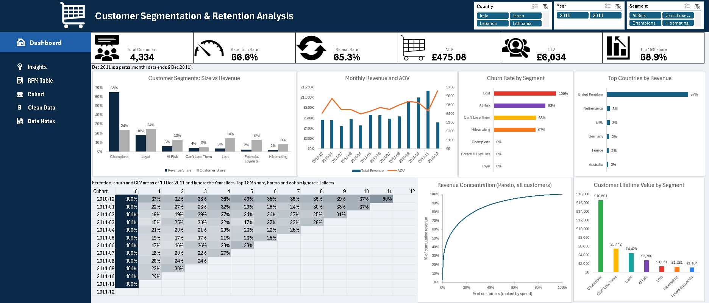
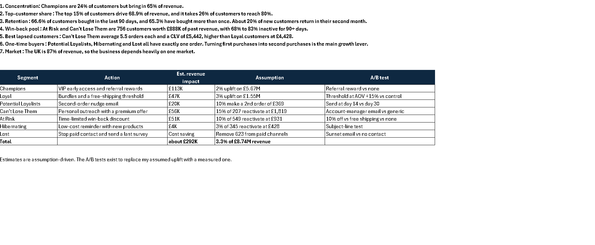
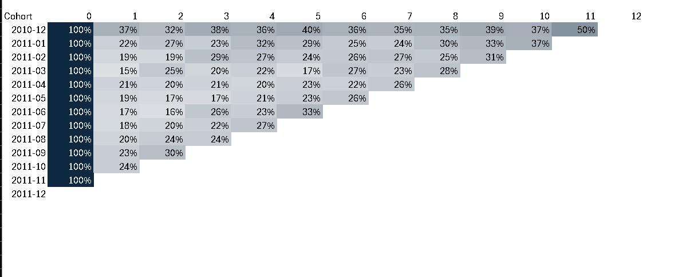
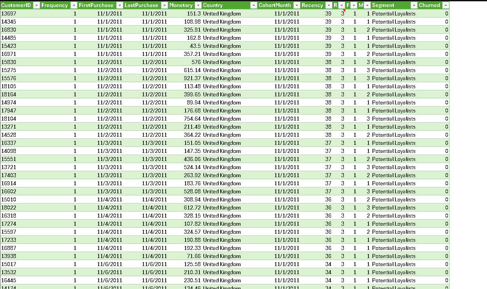
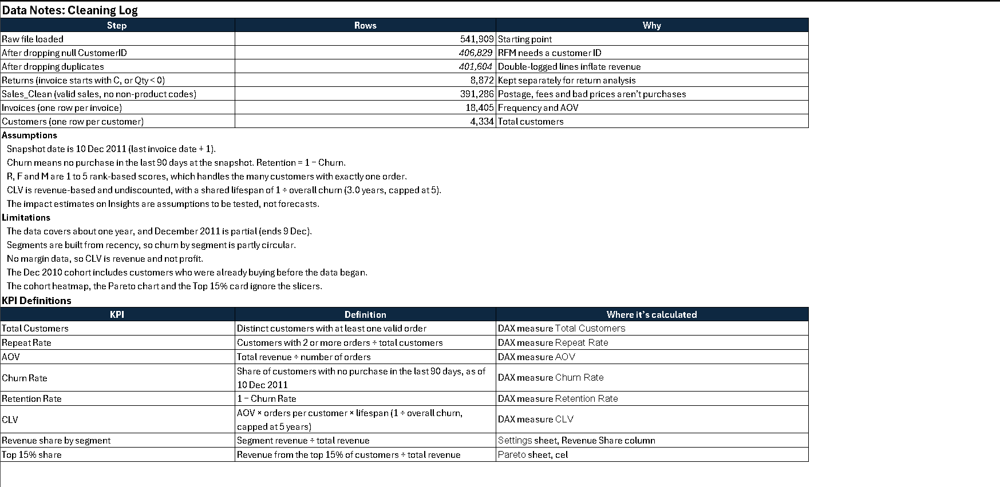

# Customer Segmentation & Retention Analysis (RFM) in Excel

An end-to-end RFM project on the UCI Online Retail dataset (Dec 2010 to Dec 2011): data cleaning in Power Query, RFM scoring and segmentation, cohort retention, churn, CLV, Pareto analysis, and an interactive dashboard with slicers, all in Excel.

## Business problem
An online retailer treats every customer the same. This project answers:
- Who are the best customers, and how much revenue do they carry?
- Which customers are slipping away, and what are they worth?
- What should the business do differently for each group?

## Headline results
| Metric | Result |
|---|---|
| Customers analysed | 4,334 |
| Revenue | £8.74M |
| Average order value | £475 |
| Repeat purchase rate | 65.3% (2,829 customers with 2+ orders) |
| Retention / churn (90-day inactivity) | 66.6% / 33.4% |
| Champions | 24% of customers, **65% of revenue** |
| Top 15% of customers | **68.9%** of revenue |
| Customers needed for 80% of revenue | 1,133 (26.1%) |
| UK share of revenue | 87% |
| Win-back pool (At Risk + Can't Lose Them) | 756 customers, £888K past revenue |

## Data and cleaning (Power Query)
Source: UCI Online Retail (541,909 transactions). Every step is logged in the **Data Notes** sheet.

| Step | Rows |
|---|---|
| Raw file | 541,909 |
| Drop rows with no CustomerID | 406,829 |
| Drop exact duplicates | 401,604 |
| Returns split out (invoice starts with "C", or Qty < 0) | 8,872 |
| Sales_Clean (valid sales, no postage/fee codes) | 391,286 |
| Invoices (one row per invoice) | 18,405 |
| Customers (one row per customer) | 4,334 |

*(Replace the two middle counts with the ones from your own Power Query if they differ.)*

## Method
1. **RFM table.** Recency (days since last order, snapshot 10 Dec 2011), Frequency (distinct orders), Monetary (total spend).
2. **Scoring.** R, F and M scored 1 to 5 using rank-based quintiles. Rank-based scoring handles the large group of customers with exactly one order, which breaks plain percentile cut-offs.
3. **Segments.** Seven segments from R and F rules: Champions, Loyal, Potential Loyalists, At Risk, Can't Lose Them, Hibernating, Lost.
4. **Churn.** No purchase in the last 90 days as of the snapshot. Retention = 1 − churn.
5. **CLV.** AOV × orders per customer × lifespan (1 ÷ overall churn, capped at 5 years). Revenue-based and undiscounted.
6. **Cohort retention.** First-purchase month vs months since, shown as a heatmap.
7. **Pareto.** Cumulative revenue by customer rank.
8. **Dashboard.** Data Model with DAX measures, PivotCharts and slicers (Segment, Country, Year).

## Segment results
| Segment | Customers | % of customers | % of revenue | CLV | 90-day inactive |
|---|---|---|---|---|---|
| Champions | 1,023 | 23.6% | 64.9% | £16,591 | 0% |
| Loyal | 1,050 | 24.2% | 17.8% | £4,428 | 0% |
| Potential Loyalists | 537 | 12.4% | 2.3% | £1,104 | 0% |
| At Risk | 549 | 12.7% | 5.9% | £2,786 | 83% |
| Can't Lose Them | 207 | 4.8% | 4.3% | £5,442 | 68% |
| Hibernating | 345 | 8.0% | 1.7% | £1,281 | 67% |
| Lost | 623 | 14.4% | 3.2% | £1,351 | 100% |

## Key insights
1. Champions are 24% of customers but bring in 65% of revenue.
2. The top 15% of customers drive 68.9% of revenue, and it takes 26% of customers to reach 80%.
3. About 20% of new customers buy again in their second month, and retention levels off around 17 to 30% afterwards.
4. At Risk and Can't Lose Them are 756 customers worth £888K of past revenue.
5. Can't Lose Them average 5.5 orders each and a CLV of £5,442, above Loyal customers (£4,428), so they are the best win-back target.
6. Potential Loyalists, Hibernating and Lost all have exactly one order. Converting first purchases into second purchases is the main growth lever.
7. The UK is 87% of revenue, so the business depends heavily on one market.

## Recommendations
| Segment | Action | Est. impact | A/B test |
|---|---|---|---|
| Champions | VIP early access, referral rewards | £113K | Referral reward vs none |
| Loyal | Bundles, free-shipping threshold | £47K | Threshold at AOV +15% vs control |
| Potential Loyalists | Second-order nudge | £20K | Day 14 vs day 30 email |
| Can't Lose Them | Personal outreach, premium offer | £56K | Account-manager vs generic email |
| At Risk | Time-limited win-back discount | £51K | 10% off vs free shipping vs none |
| Hibernating | Low-cost reminder with new products | £4K | Subject-line test |
| Lost | Stop paid contact, last-chance survey | Cost saving | Sunset email vs no contact |

Total estimated upside is about £292K (3.3% of revenue). These are assumption-driven estimates, and the A/B tests exist to replace the assumed uplifts with measured ones.

## Limitations
- About one year of data, and December 2011 is a partial month (ends 9 Dec).
- Segments are built from recency, so churn by segment is partly circular. A stricter test would score customers at an earlier date and measure who buys in the following 90 days.
- No margin data, so CLV is revenue, not profit.
- The Dec 2010 cohort includes customers who were already buying before the data begins.
- The cohort heatmap, Pareto chart and Top 15% card do not respond to slicers. Retention and churn are snapshot values and ignore the Year slicer.

## Workbook guide
Cover → Dashboard → Insights → RFM Table → Cohort → Clean Data (1,000-row sample) → Data Notes

## Screenshots
### Dashboard

### Insights

### Cohort retention

### RFM table

### Data notes

## Tools
Excel (Power Query, Power Pivot/DAX, PivotCharts, slicers, conditional formatting).
